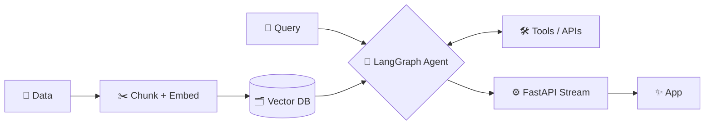

---

### 🤖 About me

I'm an **AI Full-Stack Engineer** who builds LLM-powered products end to end: the agents, the retrieval pipelines, the APIs behind them and the infrastructure that keeps them running in production.

- 🧠 **Agents** with LangGraph that plan, call tools, keep memory and loop in a human when needed
- 📚 **RAG pipelines** that turn messy documents into grounded, trustworthy answers
- ⚙️ **Backends** in FastAPI and Node.js with streaming, queues, auth and proper observability
- ☁️ **Deployment** with Docker, AWS and CI/CD, because a demo isn't a product

> 💡 *The model is the easy part. The real work is retrieval, evals and the system around it.*

---

### 🛠️ Tech stack

**AI & LLMs**

**Vector DBs & Retrieval**

**Backend, Data & Infra**

---

### ⚡ How I ship AI

---

### 🔭 Currently

- 🧪 Building multi-agent systems with memory and human-in-the-loop
- 📏 Getting serious about LLM evals and tracing
- 🔌 Connecting agents to real tools through MCP

---

📍 Lahore, Pakistan · Got an AI idea? Let's build it. 🚀

